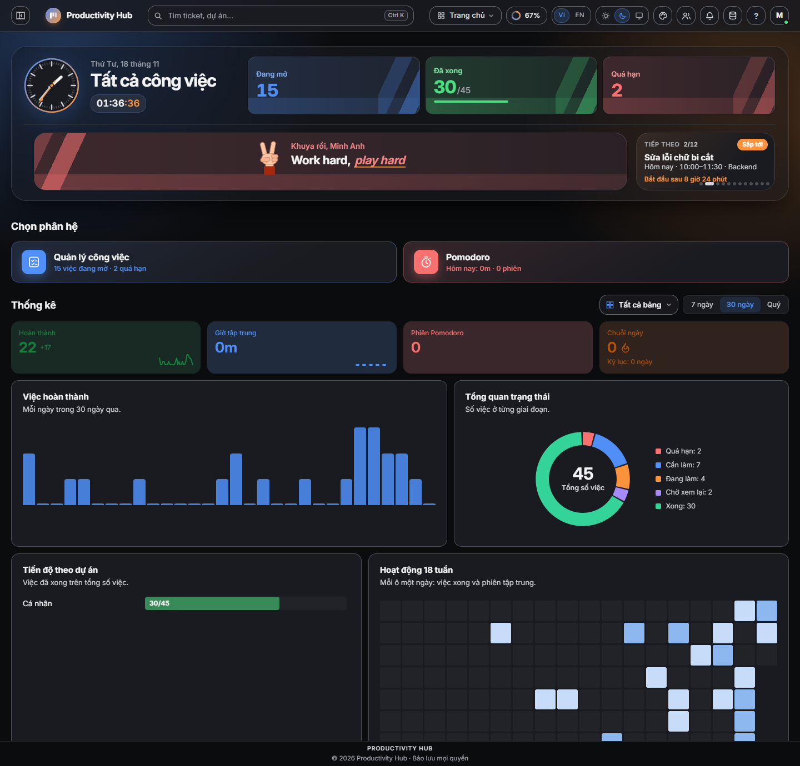
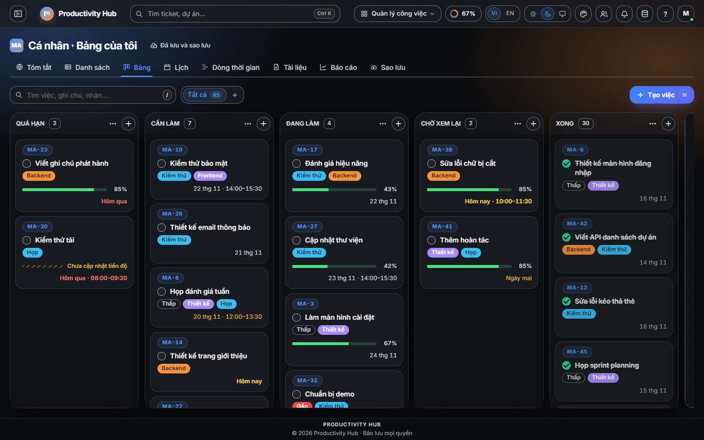
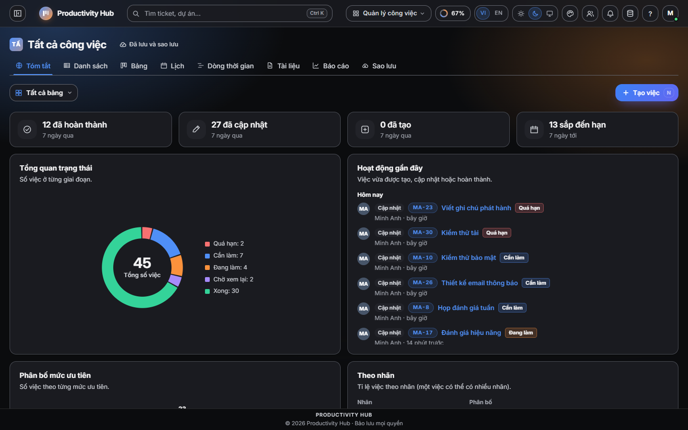
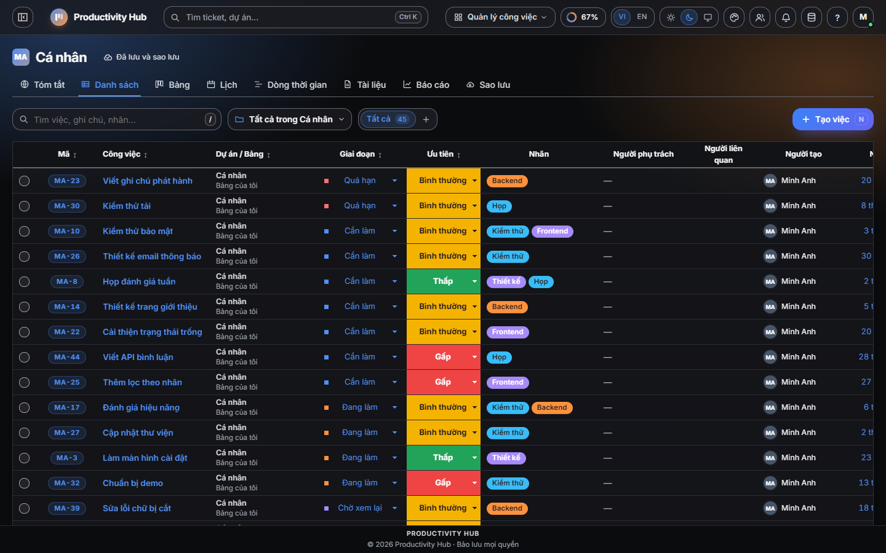
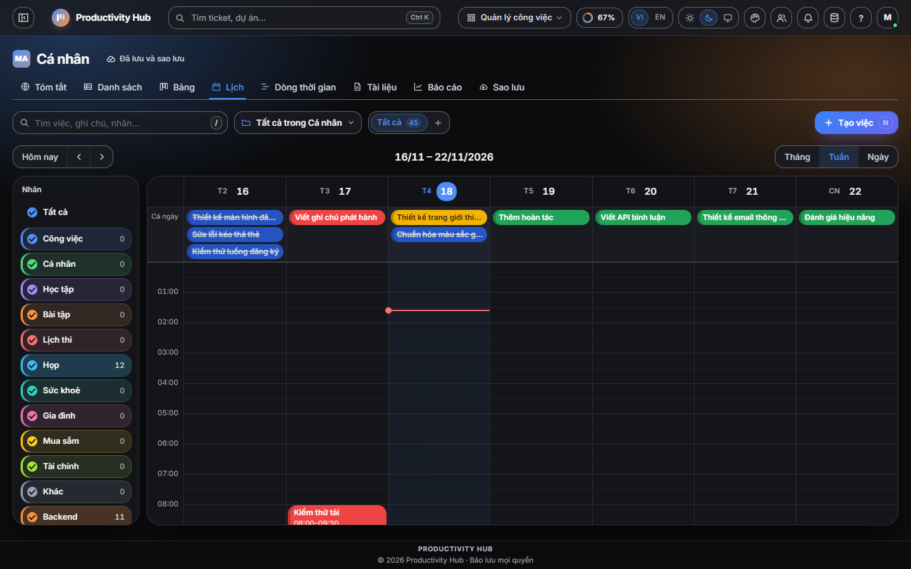
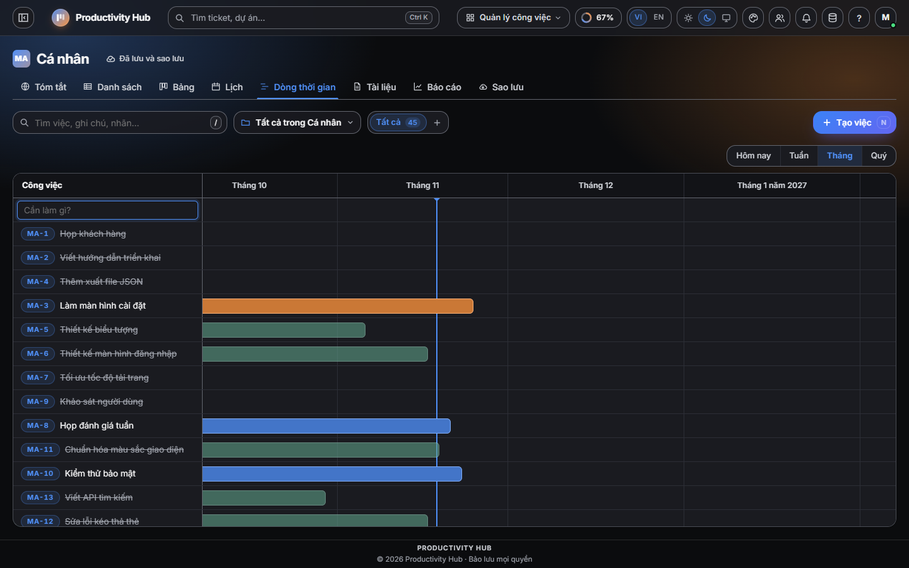
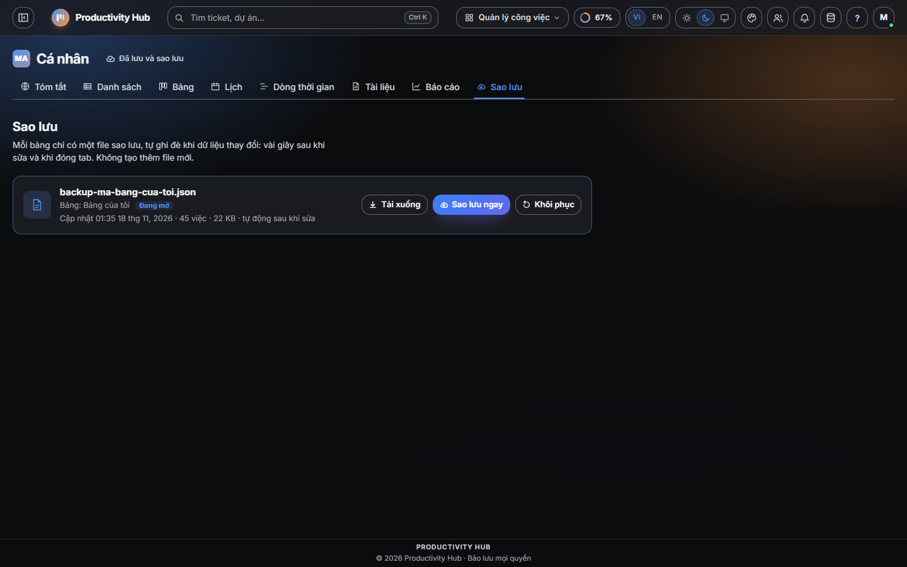
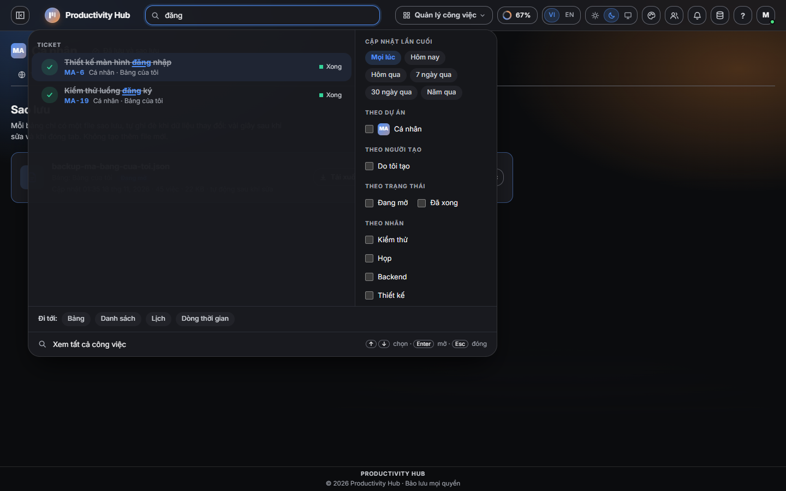
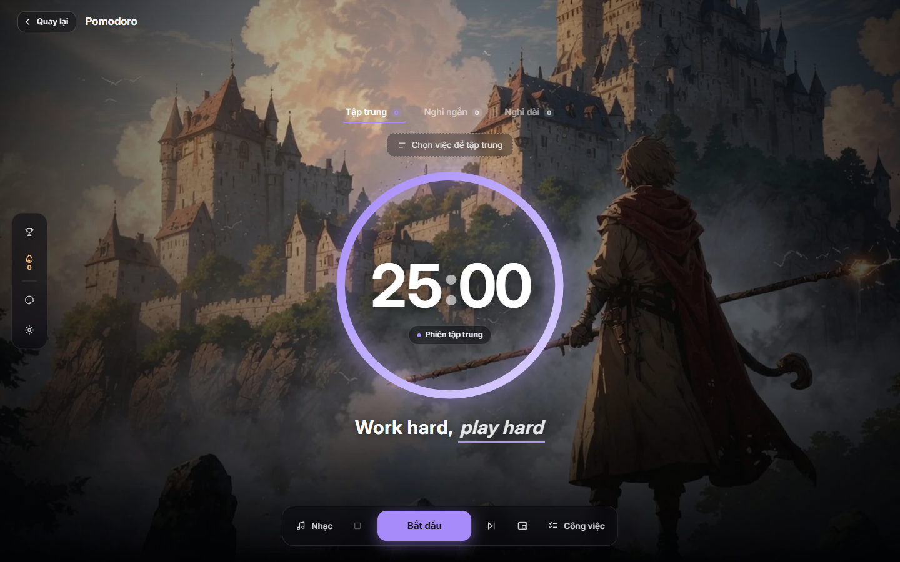

# Productivity Hub

**Một nơi gọn gàng để lên kế hoạch, theo dõi và hoàn thành công việc: một mình hoặc cùng nhóm.**
Kanban kéo thả, danh sách dạng bảng tính, lịch, thông báo nhắc việc, đồng hồ Pomodoro gắn thẳng vào việc bạn đang làm, tất cả trong một ứng dụng web chạy trên mọi thiết bị.

Bản chạy thật: <https://todoist-website-omega.vercel.app>

---

**Trang chủ**: banner, chọn phân hệ và thống kê theo dự án, theo khoảng thời gian (số việc hoàn thành, giờ tập trung, chuỗi ngày, bản đồ nhiệt).



**Bảng Kanban**: kéo thả thẻ giữa các cột, màu thẻ theo hạn, tiến độ từng việc.



**Tóm tắt dự án**: số liệu 7 ngày, biểu đồ trạng thái, ưu tiên, nhãn và hoạt động gần đây.



**Danh sách** dạng bảng tính, sắp xếp và sửa ngay trên dòng.



**Lịch** theo tuần và tháng.



**Dòng thời gian**: thanh từ ngày tạo đến hạn của từng việc.



**Sao lưu**: mỗi bảng một file sao lưu tự ghi đè, tải xuống hoặc khôi phục.



**Tìm kiếm** bằng `Ctrl K`, có bộ lọc theo dự án, người, trạng thái và nhãn.



**Pomodoro**: hẹn giờ tập trung gắn với việc đang làm.



---

## Dùng để làm gì

- **Sinh viên, người đi làm**: gom việc học, bài tập, việc cơ quan vào một chỗ; thấy ngay việc nào quá hạn, việc nào trong ngày, việc nào còn thời gian.
- **Nhóm nhỏ**: mỗi dự án có nhiều bảng, thêm bạn bè làm thành viên, giao việc cho từng người và nhận thông báo khi có thay đổi.
- **Người cần tập trung**: chọn một việc, bật Pomodoro, và mỗi phút tập trung được tính vào đúng việc đó.

## Điểm nổi bật

### Nhìn công việc theo cách bạn thích
- **Bảng Kanban** kéo thả (chuột, cảm ứng, bàn phím): đổi thứ tự thẻ, đổi chỗ cột, thêm/sửa/xoá cột, mỗi cột chọn màu riêng.
- **Trang dự án kiểu Jira** với các tab: **Tóm tắt** (số liệu 7 ngày, biểu đồ trạng thái / ưu tiên / nhãn / người phụ trách, tiến độ từng bảng, hoạt động gần đây), Danh sách, Bảng, Lịch, **Dòng thời gian** (thanh từ ngày tạo đến hạn, thu phóng Tuần / Tháng / Quý), **Tài liệu** và **Báo cáo** (gắn link Google Drive, Docs, Sheets, Notion... cho cả dự án).
- **Danh sách** dạng bảng tính: sắp xếp theo cột, đổi giai đoạn, độ ưu tiên và kéo tiến độ ngay trên bảng.
- **Lịch** theo tuần và tháng: mọi việc có hạn và giờ đều hiện trên lịch, bấm vào để mở.
- Danh sách và Lịch **gộp việc của mọi bảng** (cá nhân và các dự án bạn tham gia), có ô chọn phạm vi để lọc theo dự án hoặc bảng.
- **Tìm nhanh** bằng `Ctrl K` (việc, mã ticket, dự án) và `/` để lọc trong bảng; tìm không cần gõ dấu.

### Màu sắc nói lên tình trạng
- Thẻ **xanh lá**: còn thời gian; **vàng**: đến hạn trong ngày; **đỏ**: quá hạn; **xanh dương**: đã xong. Lịch dùng cùng màu.
- Việc quá hạn tự chuyển vào cột Quá hạn, đổi hạn sang ngày sau thì tự trả về cột cũ.
- Tiến độ (%) cho mọi việc đã bắt đầu; thẻ chưa cập nhật tiến độ có nhắc.
- Nhãn màu, bộ nhãn dùng sẵn (Học tập, Bài tập, Công việc, Cá nhân...) và bộ lọc theo nhãn, ưu tiên, hạn chót.

### Làm việc nhóm
- **Kết bạn qua email**: người nhận thấy lời mời trong chuông thông báo và chấp nhận hoặc từ chối ngay tại đó; người gửi được báo kết quả.
- **Dự án** có host và thành viên, **mỗi dự án nhiều bảng**; dự án cá nhân chỉ có mình bạn.
- **Ticket** có mã dạng `KEY-12`, người tạo và người phụ trách; avatar tròn ở góc thẻ cho biết ai đang làm.
- Người được thêm vào dự án nhận thông báo và có chấm đỏ ở thanh bên.

### Không bỏ lỡ việc
- **Chuông thông báo** nhắc trước 1 tiếng khi việc có giờ sắp bắt đầu (kèm thông báo trên màn hình nếu bạn cho phép), có đánh dấu đã đọc từng mục hoặc tất cả.
- Thông báo nhỏ ngay trong app xác nhận mỗi thao tác thành công hay thất bại, có nút Hoàn tác khi xoá.

### Pomodoro gắn với công việc
- Đồng hồ Tập trung / Nghỉ ngắn / Nghỉ dài, độ dài tuỳ chỉnh, tự chuyển phiên, chuông báo và thông báo màn hình.
- **Chọn việc để tập trung** từ mọi bảng; thời gian tập trung được cộng dồn cho từng việc.
- **Thử thách mỗi ngày**, thống kê theo tháng, chuỗi ngày liên tiếp.
- Nền ảnh và hiệu ứng (mưa, sao, tuyết...), màu nhấn, âm thanh nền (mưa, brown noise, white noise) và phát video YouTube / Spotify của riêng bạn.
- Đồng hồ vẫn chạy khi bạn quay về bảng; nút Pomodoro trên thanh trên cùng hiện số phút còn lại.

### Của bạn, dùng ở đâu cũng được
- Tài khoản riêng (email + mật khẩu), quên mật khẩu qua email, trang hồ sơ; dữ liệu đồng bộ giữa các thiết bị và vẫn dùng được khi mất mạng.
- Giao diện sáng / tối, Tiếng Việt / English.
- **Xuất / nhập JSON** để sao lưu hoặc chuyển dữ liệu; app kiểm tra file và cho xem tóm tắt trước khi nhập.
- Quản trị viên có trang quản lý tài khoản.

## Công nghệ

React 18 + Vite + TypeScript, Zustand, dnd-kit · Express 5 chạy như Vercel Function · PostgreSQL (Neon) · deploy trên Vercel.

## Bắt đầu nhanh

```bash
npm install
npm run db:migrate   # cần DATABASE_URL trong .env.local (xem phần dưới)
npm run dev:api      # API: http://localhost:3001/api/health
npm run dev          # web: http://localhost:5173
```

---

# Tài liệu kỹ thuật

Frontend React (Vite), backend Express chạy như Vercel Function, dữ liệu lưu trên PostgreSQL (Neon). Mỗi người dùng có tài khoản
riêng (email + mật khẩu). Trình duyệt vẫn giữ một bản tạm trong `localStorage` để mở nhanh và dùng được khi mất mạng; có mạng lại thì
tự đồng bộ.

## Chạy ở máy

1. Tạo file `.env.local` (không đưa lên git) theo mẫu `.env.example`, điền `DATABASE_URL` của Neon
   (nên dùng một branch riêng cho phát triển trong Neon).
2. Chạy:

```bash
npm install
npm run db:migrate   # tạo bảng và áp dụng các migration mới (chạy lại bao nhiêu lần cũng được)
npm run dev:api      # API: http://localhost:3001/api/health
npm run dev          # web: http://localhost:5173 (tự chuyển /api sang cổng 3001)
```

Sau khi kéo code mới về, nhớ chạy lại `npm run db:migrate` nếu thư mục `db/migrations` có file mới.

| Lệnh | Việc làm |
|---|---|
| `npm run dev` / `npm run dev:api` | chạy web / API khi phát triển |
| `npm run db:migrate` | áp dụng các migration SQL chưa chạy |
| `npm run typecheck` | kiểm tra kiểu cho web và API |
| `npm run build` | migrate (khi có `DATABASE_URL`) rồi build web |

## Deploy lên Vercel

1. Vercel → project → **Storage** → **Create** → **Neon** (hoặc tự tạo trên Neon rồi thêm biến `DATABASE_URL`
   trong Settings → Environment Variables).
2. Push lên nhánh `main`. Lệnh `npm run build` tự chạy migrate (tạo/cập nhật bảng) khi có `DATABASE_URL`, rồi build web.
3. Thư mục `api/` được Vercel chạy như Function; `vercel.json` chuyển mọi `/api/*` về `api/index.ts`.
4. Mở web và đăng ký tài khoản. Dữ liệu cũ ở trình duyệt (dùng trước khi có đăng nhập) thì xuất file JSON ở đó rồi nhập vào
   sau khi đăng nhập.

Kiểm tra API: `GET /api/health` trả `{ "ok": true }` khi đã kết nối được database.

> Không dán `DATABASE_URL` vào chat, ảnh chụp màn hình hay commit: chuỗi kết nối chứa mật khẩu. Nếu lỡ lộ, đặt lại mật khẩu role
> trong Neon rồi cập nhật `.env.local` và biến trên Vercel.

### Gửi email (quên mật khẩu)

Chức năng quên mật khẩu gửi email qua SMTP. Thêm các biến môi trường trong Vercel (Settings → Environment Variables), rồi deploy lại:

| Biến | Ý nghĩa |
|---|---|
| `SMTP_USER` | tài khoản gửi, ví dụ `ban@gmail.com` |
| `SMTP_PASS` | với Gmail: **Mật khẩu ứng dụng** (bật xác minh 2 bước → Tài khoản Google → Bảo mật → Mật khẩu ứng dụng), không phải mật khẩu đăng nhập Gmail |
| `MAIL_FROM` | (tuỳ chọn) tên và địa chỉ người gửi, ví dụ `"Productivity Hub" <ban@gmail.com>` |
| `APP_URL` | (tuỳ chọn) địa chỉ web để dựng liên kết trong email; mặc định lấy theo tên miền đang truy cập |
| `SMTP_HOST`, `SMTP_PORT` | (tuỳ chọn) mặc định `smtp.gmail.com`, `465` |

Chưa cấu hình thì nút "Quên mật khẩu?" báo máy chủ chưa gửi được email. Khi phát triển ở máy, đặt `MAIL_MODE=log` trong `.env.local`
để API chỉ in email (kèm liên kết đặt lại) ra cửa sổ chạy, không gửi thật.

### Cơ sở dữ liệu

Các migration nằm trong `db/migrations/` và chạy theo thứ tự tên file:

| File | Nội dung |
|---|---|
| `001_init` | người dùng, phiên, bảng, cột, việc (kèm nhãn), bộ lọc đã lưu, nhắc việc |
| `002_task_progress` | tiến độ (%) của việc |
| `003_column_card_color` | màu thẻ theo từng cột |
| `004_friends_projects` | bạn bè, dự án, thành viên |
| `005_project_boards_notifications` | nhiều bảng trong một dự án, thông báo |
| `006_personal_projects` | dự án cá nhân / dự án nhóm |
| `007_user_roles` | vai trò admin / user, khoá tài khoản |
| `008_tickets` | mã dự án, mã việc `KEY-số`, người tạo |
| `009_password_resets` | liên kết đặt lại mật khẩu |
| `010_task_activity` | lịch sử thay đổi và bình luận của việc |
| `011_avatars` | ảnh đại diện của người dùng |
| `012_project_links` | liên kết tài liệu / báo cáo của dự án (tab Tài liệu, Báo cáo) |
| `013_board_backups` | một file sao lưu cho mỗi bảng, ghi đè khi dữ liệu đổi (tab Sao lưu) |

Admin đầu tiên được đặt ngay trong migration `007`; sau đó admin đổi vai trò người khác trong trang quản lý.

## API

| Method | Đường dẫn | Mô tả |
|---|---|---|
| GET | `/api/health` | `{ ok: true }` khi kết nối được database |
| POST | `/api/auth/register` | `{ email, password, name? }` → tạo tài khoản, đăng nhập |
| POST | `/api/auth/login` | `{ email, password }` |
| POST | `/api/auth/logout` | xoá phiên |
| GET | `/api/auth/me` | người dùng hiện tại (401 nếu chưa đăng nhập) |
| POST | `/api/auth/forgot` | `{ email, lang? }` → gửi liên kết đặt lại mật khẩu (luôn trả ok để không lộ tài khoản nào tồn tại; tối đa 3 email/giờ cho mỗi tài khoản) |
| POST | `/api/auth/reset/check` | `{ token }` → kiểm tra liên kết còn dùng được, trả `email` |
| POST | `/api/auth/reset` | `{ token, password }` → đặt mật khẩu mới (liên kết dùng một lần, hết hạn sau 1 giờ), đăng xuất mọi thiết bị |
| PATCH | `/api/me` | `{ name }` → sửa tên hiển thị |
| PUT / DELETE | `/api/me/avatar` | `{ image }` (data URL PNG / JPEG / WebP, tối đa 200 KB) → đặt ảnh đại diện; DELETE gỡ ảnh |
| GET | `/api/avatars/:id?v=` | ảnh đại diện của một người (cần đăng nhập; cache lâu theo `v`) |
| GET / POST | `/api/projects/:id/links` | liệt kê / thêm liên kết tài liệu (`kind`: `doc` hoặc `report`, chỉ nhận http/https) |
| PATCH / DELETE | `/api/projects/:id/links/:linkId` | sửa / gỡ liên kết (người thêm hoặc host) |
| GET | `/api/projects/:id/backups` | tình trạng file sao lưu của từng bảng trong dự án |
| POST | `/api/backup` | sao lưu ngay một bảng (`board`, `reason`, `force`); không đổi thì không ghi |
| GET | `/api/backup/file?board=&download=1` | file sao lưu của bảng (JSON, cùng định dạng Xuất dữ liệu) |
| POST | `/api/me/password` | `{ current, password }` → đổi mật khẩu, đăng xuất các thiết bị khác |
| GET | `/api/admin/users` | danh sách tài khoản (chỉ admin) |
| PATCH | `/api/admin/users/:id` | `{ role?: 'admin' \| 'user', disabled?: boolean }` (chỉ admin, không đổi được chính mình) |
| GET | `/api/board` | `{ revision, file }`: `file` theo định dạng xuất JSON v2, `null` nếu chưa có dữ liệu |
| PUT | `/api/board` | `{ baseRevision, file, board? }` → lưu toàn bộ; 409 nếu thiết bị khác đã lưu trước |
| GET | `/api/overview` | việc, cột và người liên quan của mọi bảng bạn truy cập được (cho Danh sách và Lịch) |
| GET/POST/DELETE | `/api/friends…` | danh sách bạn bè, gửi lời mời qua email, đồng ý, từ chối / huỷ kết bạn |
| GET/POST/PATCH/DELETE | `/api/projects…` | dự án: tạo (người tạo là host), đổi tên và mã dự án (`KEY`, 2–6 ký tự, duy nhất; chỉ host), xoá, thêm/bớt thành viên |
| POST / PATCH / DELETE | `/api/projects/:id/boards`, `/api/boards/:id` | tạo bảng trong dự án (thành viên), đổi tên / xoá (host) |
| GET | `/api/tasks/:taskId/activity?board=` | lịch sử thay đổi và bình luận của một việc (cần quyền truy cập bảng) |
| POST | `/api/tasks/:taskId/comments?board=` | `{ body }` → thêm bình luận (tối đa 5000 ký tự) |
| DELETE | `/api/comments/:id?board=` | xoá bình luận của chính mình |
| GET / POST | `/api/notifications`, `/api/notifications/read` | thông báo (được thêm vào dự án, lời mời kết bạn, kết quả lời mời), đánh dấu đã đọc |

`GET /api/board?board=<id>` mở một bảng trong dự án; không có `board` là bảng cá nhân. Bảng cá nhân chỉ gắn được chính mình;
bảng dự án gắn được mọi thành viên.

Bảo mật: mật khẩu băm bằng scrypt; phiên là token ngẫu nhiên trong cookie `httpOnly`, `SameSite=Lax` (DB chỉ lưu sha256);
request ghi dữ liệu phải là JSON và cùng nguồn; khoá tạm sau 8 lần sai mật khẩu trong 15 phút.

## Tính năng chi tiết

**Bảng và việc**
- Kanban kéo thả: kéo thẻ giữa các cột, đổi thứ tự trong cột, kéo tiêu đề cột để đổi chỗ cột (chuột, cảm ứng, bàn phím Space).
- 5 cột mặc định luôn có: Quá hạn, Cần làm, Đang làm, Chờ xem lại, Hoàn thành. Việc quá hạn tự chuyển vào cột Quá hạn, đổi hạn sang ngày sau thì tự trả về cột cũ.
- Thêm, sửa, xoá cột riêng; mỗi cột chọn màu cột và màu thẻ (theo tình trạng, không màu, hoặc màu tự chọn).
- Tick ô vuông trên thẻ để chuyển việc sang cột Hoàn thành.
- Việc: tiêu đề, ghi chú, ưu tiên (Gấp / Bình thường / Thấp), hạn chót, giờ bắt đầu / kết thúc, nhãn màu, người liên quan, tiến độ (%).
- Màu thẻ theo tình trạng: xanh lá còn thời gian, vàng trong ngày, đỏ quá hạn, xanh dương đã xong; Lịch dùng cùng màu.
- Tiến độ (%) cho mọi việc đã bắt đầu (ngoài cột Cần làm); việc ở cột Hoàn thành luôn 100%. Thẻ chưa cập nhật tiến độ có nhắc.
- Ticket: mã `KEY-số` (số không dùng lại khi xoá việc), người tạo, người phụ trách.
- Hộp thoại việc hai cột: bên trái tiêu đề, mô tả và **Hoạt động** (tab Tất cả / Bình luận / Lịch sử); bên phải giai đoạn và khung Chi tiết. Lịch sử do máy chủ tự ghi khi lưu bảng (đổi giai đoạn, ưu tiên, hạn, giờ, người phụ trách, nhãn, tiến độ...); các lần kéo tiến độ hoặc gõ tiêu đề liên tiếp trong 5 phút được gộp thành một dòng.

**Các kiểu xem**
- Danh sách dạng bảng tính: sắp xếp theo cột, đổi giai đoạn / ưu tiên và kéo tiến độ ngay trên bảng. Việc thuộc bảng khác chỉ xem; bấm tên việc để mở bảng đó rồi sửa.
- Lịch tuần / tháng, lọc theo nhãn.
- Danh sách và Lịch gộp việc của mọi bảng, có ô chọn phạm vi (tất cả / một dự án / một bảng).
- Tìm kiếm không cần gõ dấu, `Ctrl K` tìm toàn bộ (việc, mã ticket, dự án), lọc nhanh việc gấp và quá hạn, bộ lọc lưu sẵn.

**Cộng tác**
- Kết bạn qua email, dự án dùng chung có host và thành viên, mỗi dự án nhiều bảng, dự án cá nhân.
- Thanh bên (nút góc trái): kiểu xem, bảng, dự án và các bảng trong dự án; chấm đỏ khi vừa được thêm vào dự án.
- Chuông thông báo: nhắc việc trước 1 giờ, được thêm vào dự án, lời mời kết bạn (chấp nhận / từ chối ngay trong chuông), kết quả lời mời; đánh dấu đã đọc.

**Pomodoro** (nút trên thanh trên cùng)
- Phiên tập trung / nghỉ ngắn / nghỉ dài, tự bắt đầu, chuông báo (5 âm tạo bằng Web Audio), thông báo màn hình, tiêu đề tab hiện số phút còn lại.
- Chọn việc để tập trung từ mọi bảng, cộng dồn thời gian theo từng việc, thử thách mỗi ngày, thống kê theo tháng, chuỗi ngày.
- Nền (ảnh hoặc vẽ bằng CSS), màu nhấn, hiệu ứng, âm thanh nền và liên kết YouTube / Spotify.
- Dữ liệu Pomodoro (nhật ký, thử thách, cài đặt, liên kết nhạc) lưu trong `localStorage` của trình duyệt (key `tm-focus`), chưa đồng bộ lên tài khoản.
- Ảnh nền nằm trong `public/focus/`. Hãy dùng ảnh bạn có quyền sử dụng; muốn đổi nền thì thay file cùng tên.

**Tài khoản và dữ liệu**
- Tài khoản riêng, quên mật khẩu qua email, hồ sơ (đổi tên, đổi mật khẩu, **tải ảnh đại diện**: chọn ảnh, kéo và phóng để cắt vuông, ảnh được thu nhỏ 256 px rồi lưu trong database), vai trò admin / user và khoá tài khoản.
- Dữ liệu lưu trên máy chủ, đồng bộ giữa các thiết bị, vẫn dùng được khi mất mạng; xung đột sửa đồng thời được báo để chọn giữ bản trên máy.
- Xuất/nhập file JSON để sao lưu hoặc chuyển dữ liệu. Khi nhập, app kiểm tra file và hiện tóm tắt trước khi thay dữ liệu. Định dạng file và gợi ý bảng PostgreSQL: [docs/export-format.md](docs/export-format.md).

**Chung**
- Hoàn tác khi xoá việc, xoá cột, nhập dữ liệu; thông báo thao tác thành công hoặc thất bại.
- Giao diện sáng và tối; chuyển ngôn ngữ Tiếng Việt / English (nút VI | EN trên thanh trên cùng). Chuỗi giao diện nằm trong `src/i18n.ts`.
- Phím tắt: `N` thêm việc, `/` tìm kiếm, `Ctrl K` tìm toàn bộ; trong Pomodoro, `Space` bắt đầu / tạm dừng.

## Cấu trúc

- `api/`: backend Express (`index.ts`), `_lib/auth.ts` (mật khẩu, phiên, vai trò), `_lib/board.ts` (đọc/ghi dữ liệu theo bảng),
  `_lib/social.ts` (bạn bè, dự án, bảng, thông báo), `_lib/overview.ts` (gộp việc của mọi bảng).
- `db/migrations/`: SQL tạo bảng; `scripts/migrate.ts` chạy các file chưa áp dụng.
- `src/sync/`: đăng nhập và đồng bộ với máy chủ (`session.ts`: gửi thay đổi sau ~0,8 giây, xử lý mất mạng và sửa đồng thời;
  `people.ts`: bạn bè, dự án, thông báo; `overview.ts`: dữ liệu gộp cho Danh sách và Lịch).
- `src/data/exchange.ts`: định dạng file xuất JSON v2 và bộ kiểm tra dữ liệu, dùng chung cho trình duyệt và API.
- `src/store/board.ts`: dữ liệu và thao tác phía trình duyệt (Zustand + persist, key localStorage `sakura-kanban`).
- `src/components/`: các thành phần giao diện (`Board.tsx`: kéo thả dnd-kit; `ListView.tsx`, `CalendarView.tsx`; `Social.tsx`: thanh bên, bạn bè, dự án; `NotificationBell.tsx`...).
- `src/focus/`: trang Pomodoro (`store.ts` đồng hồ và thống kê, `FocusPage.tsx`, `sound.ts` âm thanh, `Effects.tsx` hiệu ứng nền, `runner.ts` chạy đồng hồ ở mọi trang).
- `src/toast.ts`: thông báo nhỏ trong app.
- `src/i18n.ts`: toàn bộ chuỗi giao diện tiếng Việt và tiếng Anh.
- `src/styles.css` và các file `*.css` kèm theo: màu sắc, theme và từng khu vực giao diện.

## Sao lưu tự động

- Mỗi bảng có **một file sao lưu duy nhất**, luôn được ghi đè (không sinh thêm file). Xem, tải về và khôi phục ở tab **Sao lưu** của trang dự án.
- Không có lịch chạy ngầm: sao lưu được kích hoạt khi dữ liệu thay đổi. Máy chủ chỉ ghi khi dữ liệu thật sự đổi (so sánh mã băm). Các thời điểm sao lưu:
  - vài giây sau mỗi lần lưu của trình duyệt (trạng thái "Đang lưu… / Đã lưu và sao lưu" hiện cạnh tên dự án, kiểu Google Drive);
  - khi đóng tab (`sendBeacon`);
  - nút **Sao lưu ngay**.
- **Cảnh báo khi thoát:** chỉ khi bạn có ý định rời đi (đóng tab, tải lại, đổi địa chỉ) mà dữ liệu chưa lưu hoặc chưa sao lưu, trình duyệt hiện hộp "Rời khỏi trang?" (chữ do trình duyệt quyết định). Chọn Ở lại thì app hiện thông báo đỏ (tam giác) "Bạn chưa sao lưu dữ liệu" kèm nút **Sao lưu ngay**. Lúc đóng tab thật, app còn tự gửi lệnh sao lưu cuối.
- **Chống ghi đè nhầm:** nếu dữ liệu hiện tại ít hơn hẳn bản sao lưu (từ 4 việc trở lên mà còn dưới một nửa), bản cũ được giữ nguyên và tab Sao lưu hiện cảnh báo; chỉ ghi đè khi bạn bấm **Ghi đè bằng dữ liệu hiện tại**.
